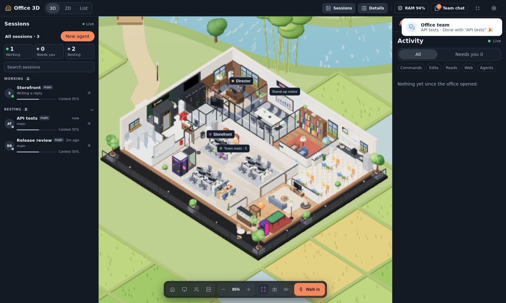

# Office 3D for Paseo

Office 3D puts your Paseo agents on a shared floor. Each workspace has a room. Pick a desk to see what its agent is doing, open the agent’s workbench over the floor, or leave the office in view while you watch for permission requests.



## Install on a host

Office 3D requires Paseo **0.16.0 or newer**. The plugin has been tested on stock Paseo 0.16.2.

1. In the host’s existing `$PASEO_HOME/config.json` (default `~/.paseo/config.json`), set `"pluginsEnabled": true`. If you changed it on a running daemon, run `paseo daemon reload`.
2. Install from the repository’s default branch.

   ```sh
   paseo plugin install git:allrested/paseo-office
   ```

   To install a particular branch or tag, add `--ref <ref>`. The host supplies the SDK and runs the bundled scene directly.

3. Open **Office 3D** in the Paseo sidebar. The gear on the floor opens **Office settings**.

## Work from the floor

| What you want to do        | Where to go                                                                                                                                                                                                                                               |
| -------------------------- | --------------------------------------------------------------------------------------------------------------------------------------------------------------------------------------------------------------------------------------------------------- |
| See who needs you          | Open **Sessions** for working, waiting and resting agents. A row shows the current activity. A checklist bar shows reported task completion. A bar labeled **Context** shows how much of the agent’s context window is in use.                            |
| Open an agent’s work       | In fullscreen, click the **↗** beside the session. In **Walk in**, face the agent and press **E** or tap the prompt. On desktop or web, the agent’s workbench opens over the office. Minimize it to revisit the floor or close it to return to your walk. |
| Reply or approve a request | Select the session row to open its conversation and permission requests. **New agent** lets you choose a workspace, provider and model, set the agent’s appearance and send the first prompt.                                                             |
| Talk to the team           | Open **Team chat** for group conversation, polls and office photos. Choose **To** or mention a session when you want that agent to act.                                                                                                                   |
| Give an idle agent a task  | Add a to-do on the **Lobby board**. Turn on **Agent tools** and **Wake agents** for automatic pickup. When an agent claims a task for its workspace, checking it off on either board completes the linked item on both.                                   |
| Schedule recurring work    | On the pantry **Duty board**, choose the days and add instructions for an agent. Duties with instructions enter the pickup queue at 08:00 on their scheduled days. Duties without instructions are acted out on the floor.                                |
| Read a stand-up            | Open **Stand-up notes** at the meeting screen to browse entries by date. Set the notes folder, days and time zone to have an agent write scheduled entries.                                                                                               |

On wide screens, **Sessions** and **Details** toggle the sidebars independently. Hide both for a full-width floor. [Workspace screenshot](https://raw.githubusercontent.com/allrested/paseo-office/main/docs/fullscreen-workspace.webp) · [Team chat screenshot](https://raw.githubusercontent.com/allrested/paseo-office/main/docs/fullscreen-team-chat.webp)

## Make the office yours

In **Office settings → Appearance**, choose Company floor, Cozy room or Headquarters. Choose City for streets and shops, Countryside, Beach or Plain for the backdrop, and App theme, Day or Night for lighting. The scene offers English, Vietnamese, Thai and Indonesian. The Office panels and team chat use English.

Under **Branding**, set the office name, logo URL and mark color. Blank fields inherit their host defaults. To change one agent’s name, character or avatar, open their session and choose **Customize agent**. [Branding environment variables](https://github.com/allrested/paseo-office/blob/main/docs/office.md#custom-branding)

## Platform support

| Client                         | Available views and controls                                                                                                   |
| ------------------------------ | ------------------------------------------------------------------------------------------------------------------------------ |
| Paseo Desktop and web browsers | 3D with WebGL 2, 2D and List. Fullscreen workbench, walk-in controls, photos and 15-second clips.                              |
| Mobile app                     | 2D and List. Mobile builds with a script-capable frame also support 3D. Use Office session controls for replies and approvals. |
| Stock Paseo 0.16               | Stop and idle-runtime cleanup depend on host SDK support. The stock 0.16 SDK lacks these operations.                           |

The Linux Host panel shows memory, CPU and processes. The floor also reflects reported agent spending, repository birthdays and team tenure. Git tags, pull-request checks and the installed Claude CLI version can trigger city activities. Weather and Jira or Sentry alerts are optional. [Feature guide](https://github.com/allrested/paseo-office/blob/main/docs/office.md) · [Compatibility checks](https://github.com/allrested/paseo-office/blob/main/docs/verified.md)

## Data and integrations

Boards, duties, team chat and stand-up state are stored under `$PASEO_HOME/office/`. View preferences are stored on the device. Clips download to the device. A custom logo is fetched from the image URL you configure.

Agent prompts, tool results and scheduled assignments go through the agent’s configured provider. A **Whole group** chat message can go to one available session with up to six recent group or scene messages for context. **To**, mentions and replies address a particular session.

Jira and Sentry use project settings and credentials from the host environment. A configured weather service receives requests while Office is open, at most once every 15 minutes. Its URL is visible in host settings. On stock hosts using fallback timers, scheduled work resumes after daemon restart when Office or an agent activates the plugin. Missed runs are skipped. [Plugin overview](https://github.com/allrested/paseo-office/blob/main/OVERVIEW.md) · [Implementation and storage](https://github.com/allrested/paseo-office/blob/main/docs/office.md)

## Development

```sh
npm ci
npm run typecheck
npm test
npm run test:scripts
npm run lint
npm run format:check
npm run check:world
```

After editing the vendored scene, run `npm run build:world` and commit the regenerated files.

## Credits and license

This is an independent community port of **my-office** by **khanh020905**, used with the author’s permission. The scene is based on upstream v0.6.0 at `b682288` and uses three.js 0.160.0. Report Paseo-specific issues in this repository. [Upstream project](https://github.com/khanh020905/my-office) · [Vendored sources and credits](https://github.com/allrested/paseo-office/blob/main/vendor/SOURCES.md) · [Issue tracker](https://github.com/allrested/paseo-office/issues) · [MIT license](https://github.com/allrested/paseo-office/blob/main/LICENSE)
